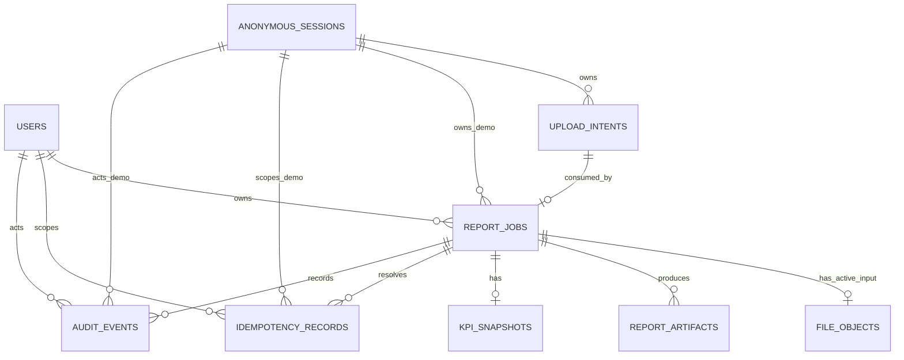

# Data Model — PostgreSQL

## Principles

PostgreSQL menyimpan state, metadata, ownership, aggregate snapshot, dan audit; bukan calculator. UUID menjadi
external ID. Secret, upload/download token, dan API key tidak disimpan. Setiap owner memakai check constraint
XOR antara `user_id` dan `anonymous_session_id`.

## ER diagram

`organization_id` adalah future field saja; multi-organization out of scope dan tidak dibuat sebagai dangling FK
sampai entity/tenancy contract disetujui.

## `users` (future production)

`id UUID PK`, `external_subject text UNIQUE NOT NULL`, nullable future `organization_id UUID`, `role text NOT
NULL`, timestamps, `disabled_at`. FK report memakai `ON DELETE RESTRICT`; deactivation lebih aman daripada hard
delete. `external_subject` tidak masuk log.

## `anonymous_sessions`

| Field | Type | Constraint |
|---|---|---|
| `id` | UUID | PK |
| `token_hash` | text | UNIQUE NOT NULL |
| `created_at`, `last_seen_at` | timestamptz | NOT NULL |
| `expires_at` | timestamptz | NOT NULL, indexed |
| `rotated_from_id` | UUID | nullable self FK, `ON DELETE SET NULL` |
| `revoked_at`, `deleted_at` | timestamptz | nullable |

Server membuat token; browser menerima cookie `HttpOnly`, `Secure`, `SameSite`; body/localStorage tidak pernah
menyimpan session ID/token. Session FK pada history `ON DELETE RESTRICT` sampai retention cleanup selesai.

## `upload_intents`

| Field | Type | Constraint |
|---|---|---|
| `id` | UUID | PK/external `upload_id` |
| `user_id` | UUID | nullable FK users, `ON DELETE RESTRICT` |
| `anonymous_session_id` | UUID | nullable FK sessions, `ON DELETE RESTRICT` |
| `safe_filename` | text | NOT NULL |
| `expected_size_bytes` | bigint | NOT NULL, positive check |
| `expected_content_type` | text | NOT NULL, allowlist check |
| `storage_provider` | text | NOT NULL |
| `object_key` | text | UNIQUE NOT NULL, sensitive |
| `state` | enum/check | `pending|uploaded|ready|expired|rejected|consumed` |
| `checksum_sha256` | text | nullable until complete |
| `created_at`, `expires_at` | timestamptz | NOT NULL, indexed |
| `completed_at`, `consumed_at` | timestamptz | nullable |

Check owner XOR. Object key dibuat server dan tidak dikembalikan oleh generic API. Unique `(owner,
client_intent_key_hash)` dapat dipakai untuk idempotency. Expired intent dibersihkan; report FK memakai
`ON DELETE RESTRICT` bila sudah consumed.

## `report_jobs`

Fields: `id UUID PK`, XOR owners, `upload_intent_id UUID UNIQUE NOT NULL`, `state`, `summary_source`,
`safe_error_code`, `request_id`, `synthetic_data`, period/currency/row count,
`deletion_reason`, `deletion_started_at`, `created_at`, `updated_at`, `completed_at`, `expires_at`, `deleted_at`.

- State check: `uploaded|validating|processing|generating_summary|rendering_reports|completed|failed|deleting|deleted`.
- Unique `upload_intent_id`; satu upload intent diproses paling banyak satu report.
- FK upload `ON DELETE RESTRICT`; owner FK `ON DELETE RESTRICT`.
- `deletion_reason`: `manual|expired|admin|policy` saat state `deleting|deleted`.

## `idempotency_records`

Fields: `id UUID PK`, XOR owners, `operation`, `key_hash`, `canonical_request_hash`, `state
(in_progress|completed|failed)`, nullable `report_job_id`, nullable safe `http_status`/`error_code`,
`created_at`, `updated_at`, dan `expires_at`.

- Unique `(owner, operation, key_hash)`; raw key, raw request, dan raw response tidak disimpan.
- Canonical request hash membedakan safe replay dari `IDEMPOTENCY_CONFLICT`.
- Record menunjuk report/result original sehingga completed atau failed replay tidak membuat job baru.
- Expiry configurable dan minimal mencakup retry window/report retention yang relevan; consumed-upload
  constraint tetap berlaku setelah record expired.
- Safe failure replay hanya menyimpan metadata minimum; tidak menyimpan stack, provider error, object key,
  raw value, atau credential.

## `file_objects`

`id`, `report_job_id UNIQUE FK ON DELETE RESTRICT`, `kind=input`, `storage_provider`, sensitive `object_key
UNIQUE`, safe filename, content type, size, checksum, status, timestamps. Unique report FK menjamin satu input
aktif per job. Metadata soft-deleted setelah verified object deletion; tombstone mengikuti audit policy.

## `report_artifacts`

| Field | Type | Constraint |
|---|---|---|
| `id` | UUID | PK |
| `report_job_id` | UUID | FK `ON DELETE RESTRICT`, indexed |
| `format` | text | `markdown|excel|pdf` |
| `generation_version` | integer | NOT NULL, positive |
| `storage_provider` | text | NOT NULL |
| `object_key` | text | UNIQUE NOT NULL, sensitive |
| `content_type` | text | NOT NULL |
| `size_bytes` | bigint | NOT NULL |
| `sha256` | text | NOT NULL |
| `status` | text | `creating|available|deleting|deleted|failed` |
| `created_at`, `available_at`, `deleted_at` | timestamptz | nullable as appropriate |

Unique `(report_job_id, format, generation_version)`. Artifact immutable. Generic detail hanya mengembalikan
artifact ID/format/size/version/availability, bukan object key/token/URL.

## `kpi_snapshots`

`id UUID PK`, `report_job_id UUID UNIQUE FK ON DELETE RESTRICT`, `schema_version`, JSONB metadata/overall/
department/category summaries, `snapshot_hash`, `created_at`. API serialization mengubah monetary/percentage
menjadi canonical decimal string; DB representation dipilih saat implementation tanpa memakai binary float
sebagai external contract.

Aggregate labels dapat confidential. Demo hanya synthetic labels. Production classification/masking berlaku
sebelum AI; pseudonym mapping disimpan server-side terpisah dan tidak dikirim provider.

## `audit_events`

Fields: `id`, nullable `report_job_id`, nullable `user_id`, nullable `anonymous_session_id`, `actor_type
(user|anonymous|system)`, `request_id`, `event_type`, `outcome`, safe metadata, `created_at`. System actor
mendukung expiration/cleanup/reconciler. Append-only; actor/report FK dapat `ON DELETE SET NULL` agar audit
tombstone bertahan. No file content, raw KPI, prompt, token/hash, object key, credential, atau provider raw error.

## Deletion dan retention

- `completed|failed → deleting → deleted`; partial failure tetap `deleting` dan retry idempotent.
- Object deletion diverifikasi sebelum final `deleted`; download ditolak sejak `deleting`.
- Expiration memakai workflow dan `deletion_reason=expired`; durable cleanup executor yang masih **Proposed**
  menangani partial failure. Automatic expiration tidak diaktifkan sebelum executor dipilih dan diuji.
- Public anonymous demo retention rekomendasi 7 hari; protected/internal demo 30 hari; keduanya Proposed.
- Tombstone/audit retention terpisah dari file/report retention; production mengikuti legal/company policy.
- Hard delete relational hanya setelah retention/audit requirements terpenuhi; default adalah soft-delete.

## Indexes dan constraints

Index state/time untuk cleanup, owner+created untuk history, expires_at, report/request IDs, artifact report/format.
Semua enums/checks, owner XOR, idempotency, upload consumption, dan one-active-input diuji di repository tests.

## Open decisions

Provider PostgreSQL, migration/ORM, future organization entity, audit/tombstone retention, pseudonym mapping
storage, dan normalized versus JSON aggregate masih **Proposed**.
