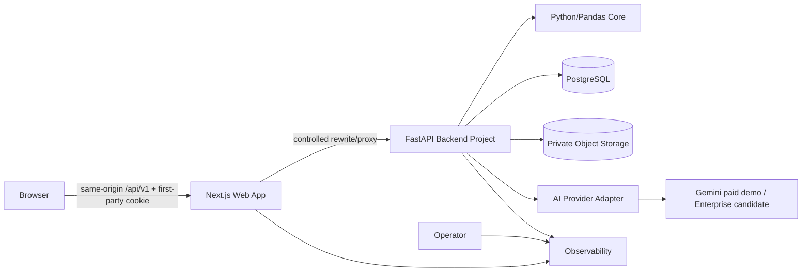
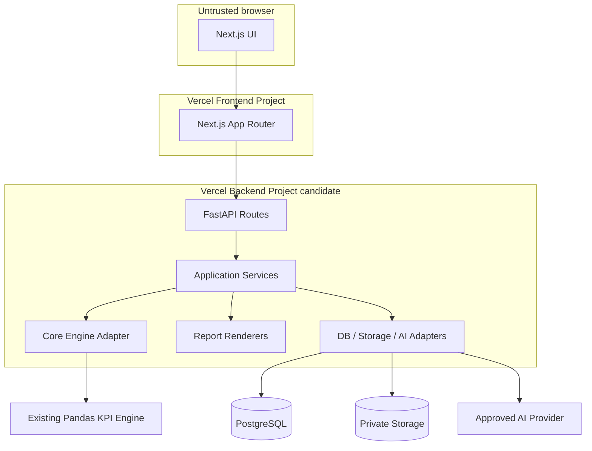
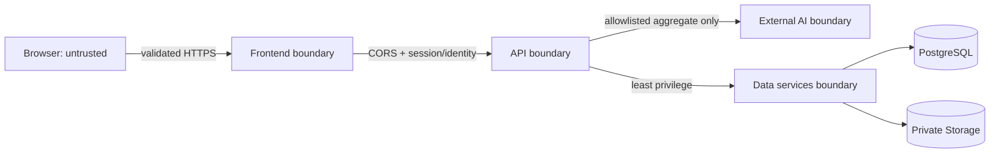
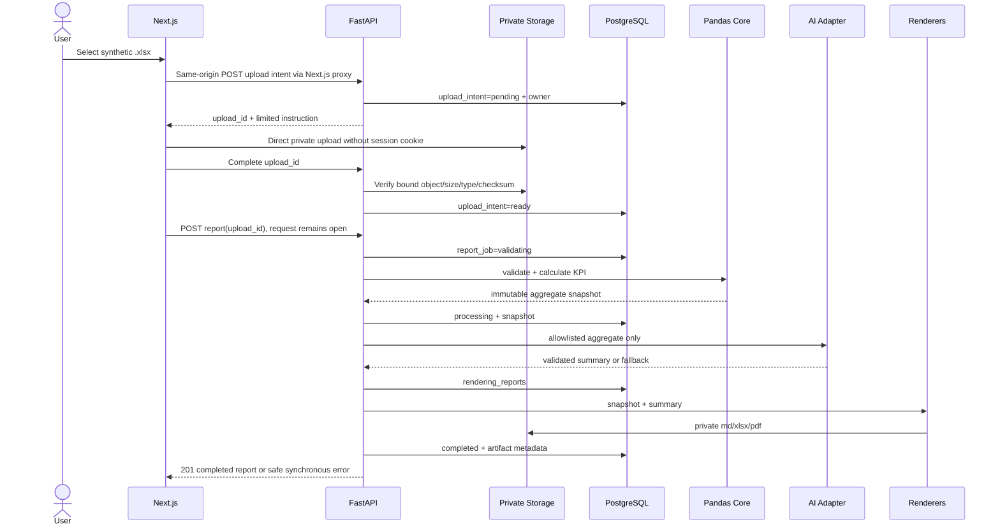
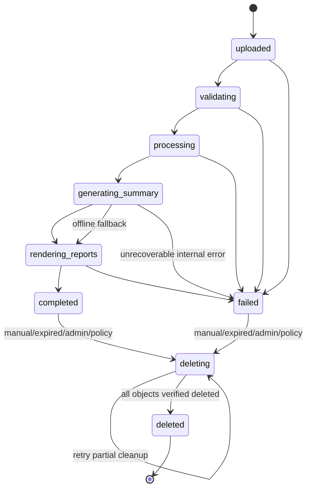
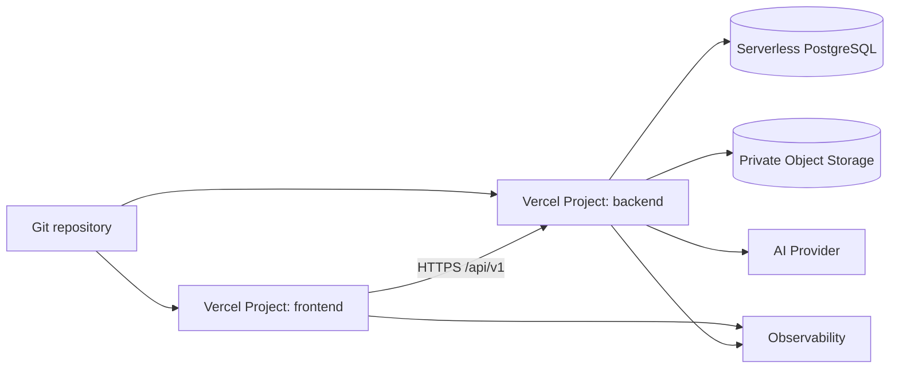

# System Architecture — Phase 2

## Prinsip

Core Phase 1 dipertahankan; Next.js tidak menghitung KPI; FastAPI adalah orchestrator; PostgreSQL hanya
menyimpan state/snapshot; LLM hanya menginterpretasi aggregate allowlist. Semua external service berada di
balik adapter. Demo tanpa login hanya untuk synthetic data.

## Context diagram

## Container/component diagram

## Responsibilities

- **Next.js:** warning, upload UX, typed API calls, state display, dashboard, history, downloads.
- **Next.js proxy:** same-origin API boundary; meneruskan cookie/CSRF/request ID/status/error/streaming.
- **FastAPI routes:** input boundary, identity/session context, rate limit hook, response/error mapping.
- **Application services:** state transitions, orchestration, idempotency, retention/delete coordination.
- **Core adapter:** map stored input ke existing validation/KPI engine.
- **AI adapter:** allowlist aggregate, classify/mask sensitive labels, provider timeout, validation, fallback.
- **Report renderer:** Markdown/Excel/PDF dari immutable snapshot.
- **PostgreSQL:** job state, ownership, metadata, snapshot, audit; bukan calculator.
- **Private storage:** raw upload dan artifacts; tidak ada public URL.
- **Observability:** redacted logs, traces, metrics, alerts.
- **Session service:** menerbitkan high-entropy cookie token, menyimpan hash, rotasi/expiry, CSRF context.

## Trust boundaries

Upload, spreadsheet text, filenames, MIME, headers, anonymous session, AI response, dan external service
errors semuanya dianggap untrusted.

Backend hanya menerima trusted frontend proxy origin/host dan tidak mempercayai spoofed forwarding headers.
Browser tidak memakai direct backend URL untuk session-bound API. Backend URL bukan authorization control.

## Upload-to-report sequence

## Synchronous v1

Dataset kecil diproses dalam request yang tetap terbuka setelah verified `upload_id` berstatus `ready`. Sukses
mengembalikan `201 completed`; validation/business failure menyimpan `failed` dan mengembalikan safe error.
Frontend menampilkan indeterminate loading, bukan realtime intermediate state. Status endpoint hanya untuk
refresh/recovery dan future async compatibility. Jika benchmark mendekati function budget, future mode memakai
`202 + polling` **hanya** setelah durable queue/workflow tersedia; tidak boleh melanjutkan pekerjaan di luar
request tanpa durable executor.

## Report state machine

`completed`/`failed` terminal untuk processing tetapi dapat masuk `deleting`; `deleted` terminal. Download
ditolak sejak `deleting`. Partial failure tetap `deleting`; expiration memakai flow yang sama. Repeated delete
idempotent. Reconciler hanya menjanjikan kelanjutan bila durable cleanup executor telah dikonfigurasi;
automatic expiration diblokir sebelum itu. Tombstone/audit retention berbeda dari file retention.

## Failure dan fallback

- Validation failure: `failed`, safe error code, input mengikuti retention/delete policy.
- AI timeout/provider error: offline summary, lanjut render, `completed`, record `summary_source=offline_fallback`.
- Renderer/storage/DB failure: `failed`; partial artifacts ditandai untuk cleanup.
- Error response tidak memuat stack, internal path, object key, prompt, raw values, atau credential.

## Download dan delete flow

Download memverifikasi owner/session, artifact state, format, expiry, lalu backend mengalirkan private object
atau memberi short-lived token scoped satu artifact; gunakan `Cache-Control: private, no-store`. Mekanisme final
streaming versus provider-authenticated delivery masih Proposed dan harus benchmark ukuran/response limit.
Delete merekam `deletion_reason`, masuk `deleting`, lalu mencoba menghapus dan memverifikasi seluruh object
dalam request. Sukses menghasilkan `200 deleted`. Incomplete cleanup menghasilkan `202 deleting` hanya dengan
durable cleanup executor; tanpa executor menghasilkan safe `503 deleting` dan repeated `DELETE` mencoba lagi.
Object yang masih ada melarang state `deleted`. Ini terpisah dari future async report-processing executor.

## Demo versus production

- Public demo: synthetic only, anonymous session, visible warning, Proposed retention 7 hari.
- Protected/internal demo: Proposed retention 30 hari.
- Production: auth/RBAC, enterprise AI, approved residency/DPA, audit, incident response, enforced retention.
- Anonymous session tidak pernah menjadi production authorization model.

## Anonymous session boundary

Server menghasilkan token high-entropy melalui cookie `HttpOnly`, `Secure`, `SameSite=Lax` atau lebih ketat,
bounded TTL. Database hanya menyimpan hash. Body tidak menerima `anonymous_session_id`; browser tidak memakai
`localStorage`. Server memvalidasi session sebelum ownership filter; cross-session menjadi `404`. Session
rotation/fixation prevention dan CSRF untuk mutating request wajib. Expiry memutus akses history.

Cookie adalah first-party pada frontend origin. Preview frontend rewrite harus menunjuk preview backend yang
sesuai; dua domain Vercel berbeda tidak diperlakukan sebagai same-site. Direct upload hanya membawa short-lived
scoped instruction. Storage CORS tidak menerima arbitrary origin/method/header dan tidak pernah menerima session
cookie atau permanent storage credential.

## Public demo abuse controls

Proposed: per-IP/per-session rate limit, active-job/stored-report/daily processing/concurrency/storage quotas,
short upload TTL, AI budget/circuit breaker, CAPTCHA/Turnstile, emergency upload/AI kill switches, dan optional
Deployment Protection preview. Angka final menunggu load/cost test.

## Deployment topology

Dua project dipilih untuk release boundary independen. Vercel Services hanya future option karena availability
harus diverifikasi. Backend hosting alternatif diperlukan bila Python runtime, upload flow, PDF dependency,
duration, atau bundle tidak memenuhi gate.

## Open decisions

Sync/queue threshold, backend host, database/storage region, PDF renderer, dan observability provider masih
**Proposed**.
